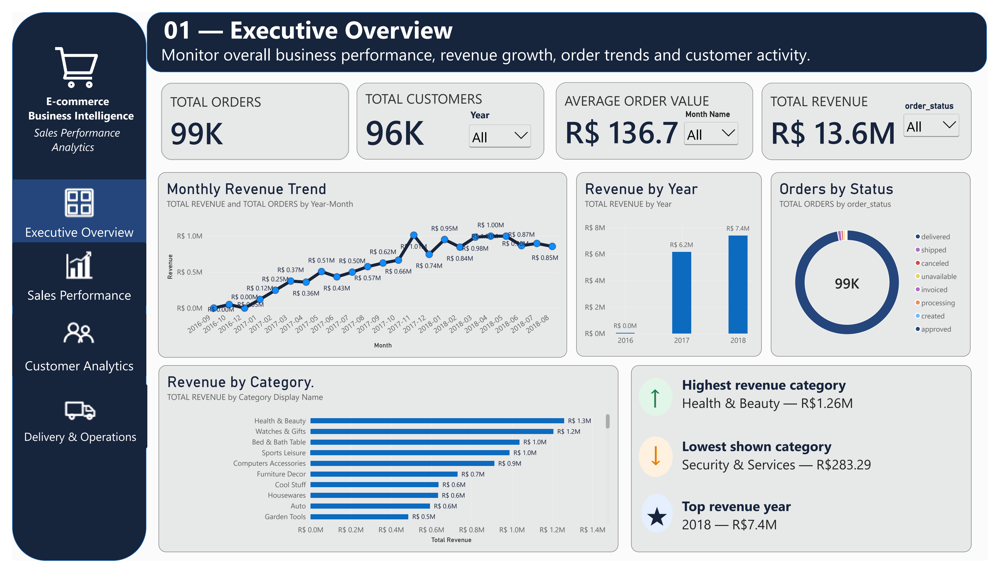
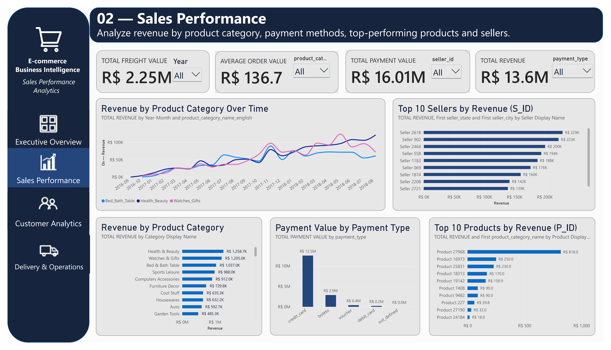
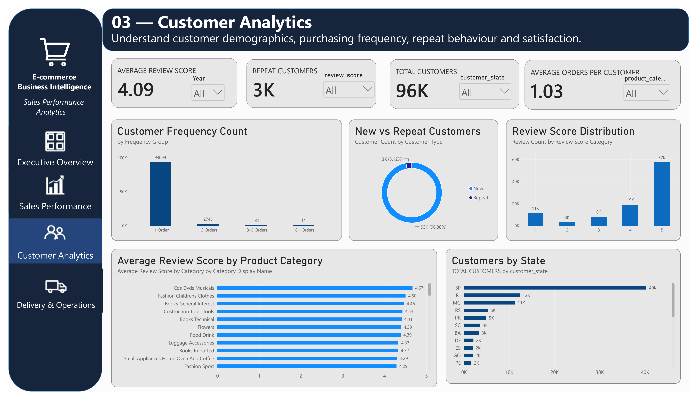
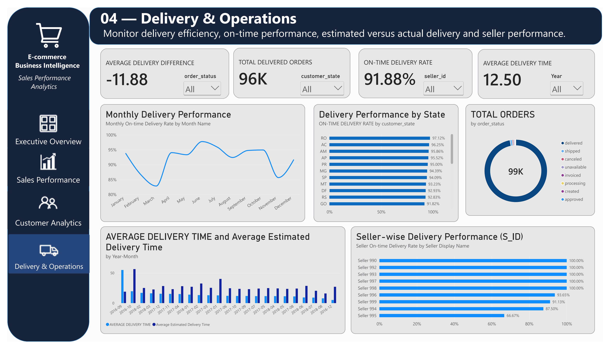

# 🛒 E-commerce Business Intelligence & Sales Performance Analytics

**Turning e-commerce data into business insights with SQL Server and Power BI.**

An end-to-end Business Intelligence project exploring sales performance, customer behavior, product trends, and delivery operations using the Brazilian Olist e-commerce dataset.

---

## 📊 Project at a Glance

| Project Area | Details |
|---|---|
| Domain | E-commerce & Business Intelligence |
| Dataset | Brazilian Olist E-commerce |
| Data Volume | Approximately 99K orders and 96K customers |
| Database | SQL Server |
| Visualization | Power BI |
| Dashboard Pages | 4 |
| Core Focus | Sales, Customers, Products & Operations |

## 🖥️ Dashboard Preview

The project contains four interactive dashboard pages designed to provide different perspectives on business performance.

### 1. Executive Overview
A high-level view of business performance, revenue trends, and product category contributions.



### 2. Sales Performance
Analyzes revenue, payment methods, product categories, and top-performing products and sellers.



### 3. Customer Analytics
Explores customer distribution, purchasing frequency, repeat customers, and review patterns.



### 4. Delivery & Operations
Evaluates order fulfillment, delivery timelines, on-time performance, and seller-level delivery trends.



---

## 🎯 Business Objectives

- Evaluate overall sales and revenue performance.
- Identify high-performing and low-performing product categories.
- Understand customer purchasing behavior and retention patterns.
- Analyze customer satisfaction through review scores.
- Measure delivery efficiency and operational performance.
- Convert transactional data into meaningful business insights.

## 🛠️ Tools & Technologies

| Technology | Application |
|---|---|
| SQL Server | Data cleaning, transformation, and validation |
| Power BI Desktop | Data modeling and interactive dashboards |
| DAX | KPI development and analytical calculations |
| Power Query | Data preparation and transformation |

## 🔍 Data Preparation & Modeling

SQL Server was used to prepare and validate the source datasets before connecting them to Power BI.

Key activities included:

- Data cleaning and consistency checks.
- Identifying and handling missing and duplicate records where appropriate.
- Preparing cleaned tables for analytical use.
- Establishing relationships across customers, orders, products, sellers, payments, and reviews.
- Creating a date table for time-based analysis.
- Validating business metrics and analytical results.

The prepared data was then modeled in Power BI to support consistent reporting and interactive analysis.

## 📈 Key Business Metrics

The dashboards include business performance indicators such as:

- Total Revenue
- Total Payment Value
- Total Freight Value
- Average Order Value
- Total Customers
- Repeat Customers
- Average Review Score
- On-time Delivery Rate
- Average Delivery Time

## 💡 Skills Demonstrated

- SQL data cleaning and validation
- Relational data modeling
- Power BI report development
- DAX measures and KPI calculations
- Power Query transformations
- Interactive data visualization
- Sales and customer analytics
- Operational performance analysis
- Business-focused data storytelling

## 📁 Project Structure

```text
Ecommerce-Business-Intelligence-PowerBI/
│
├── PowerBI/
│   └── Ecommerce_Business_Intelligence_Sales_Analytics.pbix
│
├── SQL/
│   └── SQL cleaning and validation scripts
│
├── Dashboard_Screenshots/
│   ├── Executive_Overview.png
│   ├── Sales_Performance.png
│   ├── Customer_Analytics.png
│   └── Delivery_Operations.png
│
├── Documentation/
│   └── Ecommerce_Business_Intelligence_Dashboard.pdf
│
└── README.md
```

## 📂 Project Deliverables

- **Power BI Report:** Interactive `.pbix` report.
- **SQL Scripts:** Data cleaning and validation queries.
- **Dashboard Screenshots:** Visual previews of all four dashboard pages.
- **Dashboard Documentation:** PDF containing the completed dashboard pages.

## 🚀 Project Takeaway

This project demonstrates an end-to-end Business Intelligence workflow, from preparing transactional data in SQL Server to developing interactive Power BI dashboards.

The objective was not simply to create visuals, but to build a reliable analytical foundation, define meaningful business metrics, validate results, and communicate insights that support better business decisions.

---

**Built with SQL Server | Power BI | DAX | Power Query**

